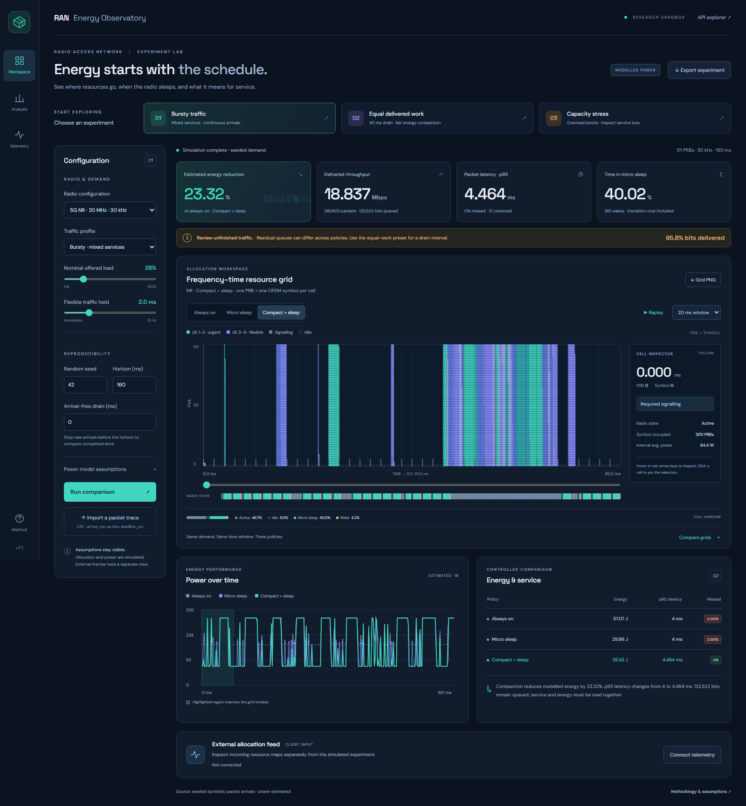
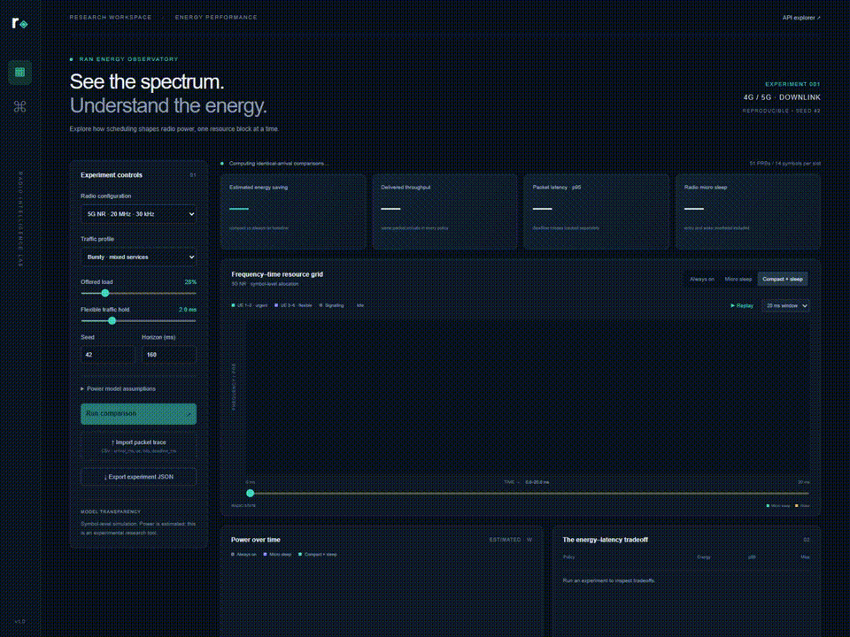
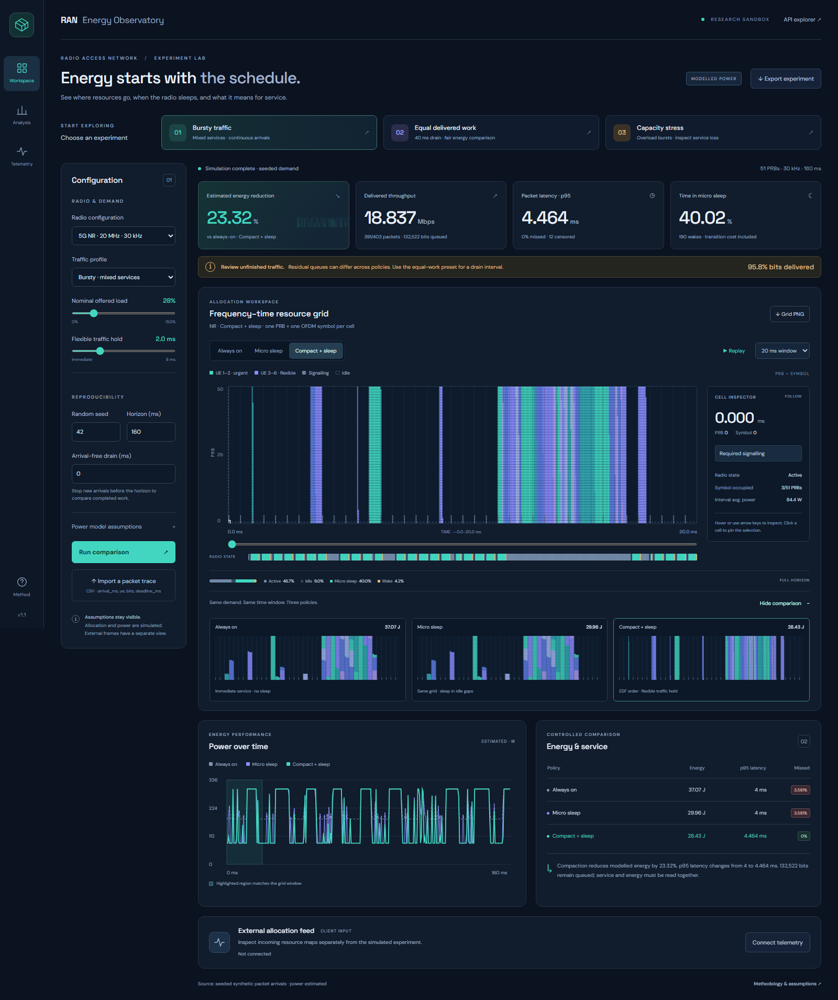
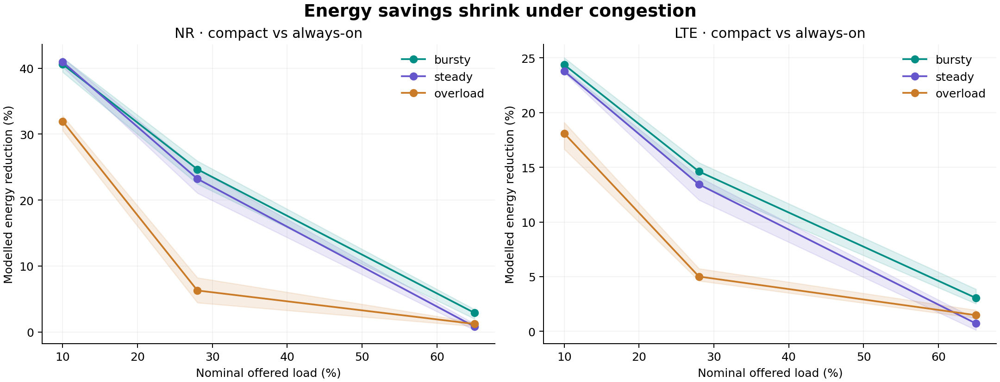
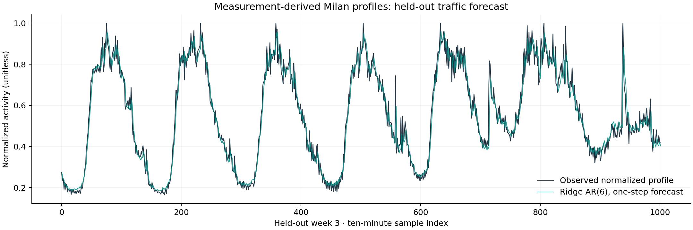

# RAN Energy Observatory

**See the spectrum. Understand the energy.**

A working research workspace for exploring how **4G LTE / 5G NR scheduling, Physical Resource Block allocation and transmit micro sleep** affect radio energy and packet service. It combines an interactive frequency–time grid, a packet scheduler, an explicit power model, live allocation-frame ingestion and reproducible experiments.

[](https://github.com/Pavan-amikula/ran-energy-observatory/actions/workflows/ci.yml)     



## Watch it work



**[Watch / download the full MP4 demonstration](results/demo.mp4)** · [LTE screenshot](results/lte-dashboard.png) · [Mobile screenshot](results/mobile-dashboard.png)

The updated research workbench adds **one-click experiments, a cell inspector, synchronized policy previews, linked power-chart navigation and grid PNG export**. The service summary distinguishes equal completed payload from unfinished queues and overloaded service.



[Equal-work preset screenshot](results/equal-work-dashboard.png) · [Interface review and design rationale](docs/interface-research.md)

The recording shows actual application interactions: policy comparison, animated grid replay, time scrubbing, LTE configuration, overload traffic, packet CSV import and JSON export. It is a screen recording of the running local app.

## The research question

Can arranging traffic into fewer active transmit intervals create useful sleep opportunities without unacceptable packet delay?

The key distinction is **frequency idle versus radio idle**. A partially empty PRB column can still require the transmitter to stay active. Whole-symbol gaps with no required signalling or payload create possible sleep opportunities. A scheduler can expose those gaps by consolidating flexible traffic. The benefit must be assessed alongside latency, deadline misses and undelivered demand.

Ericsson's published Micro Sleep Tx / Low Energy Scheduler descriptions motivate the experiment. The scheduler here is an original educational implementation of the published principle, with configurable assumptions; it does not reproduce proprietary feature logic. [Ericsson case study](https://www.ericsson.com/4ae555/assets/local/cases/customer-cases/2022/tackling-network-energy-consumption.pdf)

## Run locally

Requires Python 3.12 or later. From the repository root:

```bash
python -m venv .venv
# Windows PowerShell:
.venv\Scripts\Activate.ps1
# macOS / Linux: source .venv/bin/activate
python -m pip install -r requirements.txt
python -m uvicorn app.main:app --host 127.0.0.1 --port 8000
```

Open **[the dashboard](http://127.0.0.1:8000)** or **[interactive API documentation](http://127.0.0.1:8000/docs)**.

Docker alternative:

```bash
docker build -t ran-energy-observatory .
docker run --rm -p 127.0.0.1:8000:8000 ran-energy-observatory
```

The native Python path was executed and verified. The Docker recipe is provided but was not executed in the development environment.

## What you can do

| Capability | Implementation |
|---|---|
| Inspect the frequency–time domain | Symbol-resolution PRB grid, numerical axes, hover / click-to-pin cell inspector, keyboard navigation, time windows and scrubbing |
| Compare a common time window | Synchronized previews for all three policies; power overview highlights and navigates the same window |
| Start a meaningful experiment | Bursty, equal-work with a 40 ms drain, and overload presets; delivered-work and deadline context beside the energy KPIs |
| Compare scheduling decisions | Cyclic UE-priority frequency-major baseline; the same allocations with micro sleep; EDF traffic consolidation with micro sleep |
| Explain power saving | Active / idle / sleep / wake states, configurable power parameters and explicit transition energy |
| Observe service quality | Throughput, completed packets, queued bits, p95 packet latency, deadline misses, censored packets and delivery fairness |
| Exercise 4G and 5G configurations | LTE: 100 PRBs / 15 kHz / 1 ms scheduling interval. NR: 51 PRBs / 30 kHz / 0.5 ms slot |
| Explore traffic shapes | Steady, bursty, overload and a published measurement-derived Milan activity envelope |
| Bring a packet trace | CSV upload with validation and identical trace replay for each policy |
| Receive external allocations | REST ingestion, bounded 500-frame memory buffer, dashboard polling and a separate external-frame visualization |
| Stream a demonstration | Server-Sent Events with explicitly labelled paced simulation replay |
| Reproduce findings | Seeded experiments, exported CSV/JSON and grid PNG, equal-payload checks, sensitivity analysis and automated tests |
| Explore machine learning | Ridge AR(6) activity forecasting on held-out week-labelled Milan profiles, compared against persistence |

## Results with evidence

### Equal delivered work: five seeded trials

NR, bursty demand, nominal load 0.28, 160 ms common observation window, arrivals stopped at 120 ms to allow a 40 ms drain. **All three policies finish exactly the same offered bits in each trial**, with zero residual backlog. Defaults: 180 W active-idle, 120 W load slope, 45 W sleep, 0.15 mJ wake.

| Measure | Result |
|---|---:|
| Compact energy reduction vs always-on, mean over five seeds | **30.90%** |
| Compact energy reduction, seed range | **28.78–32.00%** |
| Mean energy, always-on → compact | 34.57 J → 23.89 J |
| Mean of per-run p95 latency, always-on → compact | 3.545 ms → 4.125 ms |
| Compact deadline misses in these trials | 0% |
| Backlog after drain, every policy | 0 bits |

These are **simulation results under illustrative power assumptions**, not measured Ericsson hardware savings. Consolidation also changes packet priority to EDF; the difference includes scheduling-order and packing effects. Evidence: [complete equal-work results](results/equal-work.json) and [reproduction script](scripts/equal_work.py).

### Broader study: 90 paired configurations / 270 policy evaluations

Two radio configurations × three demand profiles × three nominal loads × five seeds. Every comparison reuses the same packet arrivals and UE payload capacities. The table shows compact policy means over five seeds.

| Radio / profile / nominal load | Estimated energy saving | Mean p95 latency | Mean deadline miss rate | Mean queued bits |
|---|---:|---:|---:|---:|
| NR / bursty / 0.10 | 40.58% | 2.182 ms | 0% | 14,714 |
| NR / bursty / 0.28 | 24.66% | 4.005 ms | 0% | 143,002 |
| NR / steady / 0.65 | 0.81% | 12.619 ms | 6.413% | 538,911 |
| NR / overload / 0.65 | 1.21% | 76.486 ms | 94.917% | 6,949,746 |
| LTE / bursty / 0.28 | 14.61% | 6.001 ms | 0% | 114,277 |

The overloaded case is a **service failure**, despite a positive energy percentage. Inspect unfinished traffic and deadline misses before interpreting a saving. These continuous-arrival runs can end with different queued payload; the equal-work experiment above controls for that issue. Seed ranges describe these selected random realizations, not field confidence intervals.



[All 270 per-policy records](results/benchmark.csv) · [18 group summaries](results/summary.json) · [Power-parameter sensitivity](results/sensitivity.csv) · [Default experiment including full grids](results/example.json)

### Traffic forecasting on measurement-derived profiles

A six-lag ridge autoregression with daily sine/cosine features trains on week labels 1–2 and evaluates on held-out week label 3, using only observed previous activity values for one-step predictions. No shuffled train/test split. There are 2,010 training and 1,002 test examples.

| Predictor | MAE | RMSE |
|---|---:|---:|
| Persistence, last observed value | 0.03945 | 0.05651 |
| Ridge AR(6) | **0.03614** | **0.05216** |

MAE improves by approximately 8.38% on this subset. The target is **unitless normalized traffic activity**, not energy or PRB occupancy. Week dates are not independently verified; these are published profiles rather than a raw operational time series. This offline forecasting experiment does not control the live scheduler.



[Metrics, model coefficients and split details](results/forecast-metrics.json) · [Every held-out prediction](results/forecast-predictions.csv)

## Data and research foundation

The project bundles 21 daily, measurement-derived Milan internet-activity profiles: one square, three week labels, seven days and 144 ten-minute samples per day. The upstream source is pinned and SHA-256 hashed in [data/provenance.json](data/provenance.json). For the dashboard's Milan scenario, one daily profile is mean-normalized and compressed into the simulation horizon to modulate synthetic packet arrivals. This preserves a traffic *shape*; it does not reconstruct historical sub-millisecond allocations.

Data attribution: **[from BigDataChallenge contest](https://theodi.fbk.eu/openbigdata/)**. The subset comes through [mob-traffic-ds](https://github.com/arimvydas/mob-traffic-ds) and is separately licensed; see [data/NOTICE.md](data/NOTICE.md), the upstream GPL copy, and the original [Telecom Italia dataset](https://doi.org/10.7910/DVN/EGZHFV) under ODbL. The project's MIT license covers the original code, not this separately licensed data.

[Research notes](docs/research.md) review the 3GPP grid definitions, Ericsson energy features, analytical power models, measured energy-model papers, srsRAN dashboards, 5G-LENA and dataset access terms. No srsRAN, ns-3 or 5G-LENA experiment is claimed here. Their published tools inform interface design and future validation.

## Reproduce validation and experiments

```bash
python -m pip install -r requirements-dev.txt
python -m pytest -q
python -m scripts.benchmark
python -m scripts.equal_work
python -m scripts.forecast
python -m scripts.figures
```

The test suite verifies deterministic arrivals, bit conservation, sleep accounting, transition cost, mandatory-signalling constraints, overload, completion timing, censoring, exact-horizon deadlines, equal-work drain, LTE/NR geometry, CSV validation, external ingestion and SSE labelling. The original environment passed **14 tests** and the browser interaction checks. A CI workflow reruns the computational checks and exports result artifacts.

To repeat the real browser recording, start the server and run:

```bash
python -m playwright install chromium
python -m scripts.capture_demo
python -m scripts.export_video
```

Browser checks cover policy tabs, synchronized grid previews, cell inspection and keyboard pin/release, PNG export, linked chart navigation, all three presets, replay, LTE, unapplied-input indication, CSV import/clear, JSON export, telemetry connection, a short horizon with a larger window, and responsive layouts at 360, 390, 768, 1024 and 1280 px. See [browser-validation.json](results/browser-validation.json). `scripts/fetch_profiles.py` can regenerate the licensed subset from the pinned upstream source; internet access is needed only for fetching and browser installation.

## Packet traces and telemetry

Upload [data/example_packets.csv](data/example_packets.csv) in the UI. Columns are `arrival_ms,ue,bits,deadline_ms`. `deadline_ms` is the **relative** packet deadline; UE IDs are 1–6. Arrival times are rounded **up** to the next scheduling boundary. Latency in imported traces is measured from that quantized arrival, so sub-interval arrival wait is excluded. Selecting a traffic profile clears the imported trace.

| Endpoint | Purpose |
|---|---|
| `POST /api/compare` | Validated experiment config → all three policy results and grids |
| `POST /api/trace` | Config + CSV text → paired packet-trace experiment |
| `GET /api/stream` | Paced simulation replay via SSE, labelled in every event |
| `POST /api/telemetry` | Client allocation frame → estimated power and bounded storage |
| `GET /api/telemetry` | Most recent 40 received frames |
| `GET /api/health` | Status and model version |

A telemetry frame supplies `source`, `timestamp_ms`, `radio` and `grid`: **14 time rows × 51 NR or 100 LTE PRB columns**. Entries are `-1` signalling, `0` idle or UE IDs `1–6`. This input orientation differs from the visualization response, which is PRB-major. API validation rejects malformed dimensions and IDs.

```bash
# While the dashboard/server is running:
python -m scripts.send_telemetry
```

Click **Connect telemetry** in the dashboard. This sender uses simulated allocations and identifies itself accordingly. The sender → HTTP ingestion → advancing browser-frame path was verified; see the [telemetry screenshot](results/telemetry-dashboard.png). A real SDR or testbed integration would need an adapter that supplies actual allocation maps; aggregate throughput counters cannot reconstruct them. External frames use independent per-frame sleep accounting. No end-to-end hardware integration is claimed.

## Model boundaries and next research steps

- NR uses 14 average-duration symbols per slot; LTE's 1 ms display combines two physical slots. Cyclic-prefix duration variation is averaged.
- The mandatory signalling mask is deliberately simplified. It is not a full CRS / SSB / PDCCH / DM-RS mapping. The effective per-cell payload fraction is an abstraction.
- Power uses `active_idle_w + load_slope_w × occupied_fraction`, with a lower sleep state, two entry symbols, one wake symbol and an integrated wake-energy cost. A sleep gap is accepted only when its modelled benefit exceeds wake cost.
- No calibrated RF hardware, HARQ, propagation, interference, TDD, MIMO, mobility or multi-cell control is simulated. No physical energy model was trained using the synthetic labels.
- The cyclic baseline and EDF consolidation policy differ in both traffic order and packing. Additional ablations should separate those factors for publication-quality causal attribution.
- Next validation steps: controlled SDR allocation traces, synchronized measured radio power, a pinned srsRAN metrics adapter, standards-faithful signalling masks, channel-aware capacity, longer runs with warm-up/drain and calibration uncertainty.

See [architecture and design decisions](docs/architecture.md), [interview walkthrough](docs/demo-guide.md) and the [complete project brief for resume preparation](PROJECT_BRIEF.md).
