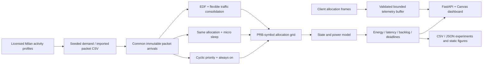

# Architecture and design decisions

## Components

- `app/engine.py`: validated configuration, seeded packet arrivals, CSV trace normalization, scheduling, state inference and energy integration. Each policy receives the same packet objects; remaining bits and completion records are local to each run.
- `app/main.py`: synchronous computational endpoints run through FastAPI's thread pool; the async replay endpoint offloads the simulation before emitting paced events. External frames have a strict 14-symbol shape and a bounded deque. This is a single-process local research API; the memory buffer is not shared across multiple server workers.
- `app/static/`: plain JavaScript + responsive CSS + Canvas charts. No frontend build step or chart CDN is required. Fonts have local fallbacks. Synchronized preview grids share the detailed grid's time window; an inspector reads PRB/symbol allocation and interval-average power directly from the selected result. The power overview highlights that same window. Input modifications are marked until a new experiment succeeds. The external allocation preview is separate from simulation KPIs to preserve provenance.
- `scripts/benchmark.py`: 90 paired configurations, 270 policy evaluations. All seed-level outputs retained.
- `scripts/equal_work.py`: drain-window experiments assert zero backlog and identical delivered bits; power sensitivity holds traffic seed fixed.
- `scripts/forecast.py`: independent normalized activity prediction, with train/test split and a naive persistence comparator.
- `scripts/figures.py`: static figures built from the exported numerical evidence.

## Allocation and latency semantics

There are six UEs. IDs 1–2 are assigned 4 ms relative deadlines; IDs 3–6 have 15 ms. Synthetic packets arrive on scheduling boundaries. UE capacities are fixed effective payload bits per PRB-symbol, derived from illustrative spectral efficiencies and a payload fraction. Nominal offered load uses a 4 bits/RE reference; actual payload utilization differs with random packet sizes and UE capacities.

The baseline rotates UE service priority by interval and allocates available cells frequency-major, spreading allocations through symbols. This is a simple cyclic-priority baseline, not a standards-complete round-robin or proportional-fair scheduler. Micro sleep uses exactly the same grid. Compaction serves eligible packets by earliest deadline and fills frequency resources in a symbol before advancing time. Urgent packets bypass deliberate batching. Flexible backlog flushes after the configured age, near a deadline or when the backlog approaches interval capacity. A flush decision does not guarantee the entire queue can be served under overload.

A packet completes at its **latest allocated symbol boundary**, which matters when baseline traversal order is not chronological. All allocated bits count towards throughput, including a transmitted prefix of an unfinished packet. Completion latency uses only completed packets. An incomplete packet whose deadline is inside or exactly at the observation horizon counts as missed; an incomplete packet whose deadline is later is censored. Miss rate denominator excludes these censored packets. Packets are never silently dropped at deadlines. Delivery fairness applies Jain's index to per-UE delivered/offered ratios for UEs with offered demand.

## Sleep semantics

Signalling and payload both keep a symbol active. Active-idle power is paid on empty symbols unless a profitable whole-symbol sleep interval is found. Two entry symbols and one wake symbol are retained; transition energy is added to the wake symbol's power so integration counts it exactly once. The final horizon gap also pays a wake cost, a conservative modelling convention. The state trace is an analytical overlay on a computed allocation schedule, not a hardware controller or online sleep decision algorithm. Telemetry repeats this computation independently for each input frame.

## Tradeoffs

Symbol-level resolution explains gaps better than averaged PRB load, but a simplified PHY enables fast local experiments. Full 3GPP compliance requires a much larger simulator or SDR testbed. Vanilla Canvas keeps the delivered project runnable with only Python dependencies. Original code is MIT; the selected published data stays separately licensed. Paired seeds reduce arrival-trace confounding, while equal-work drain experiments avoid mistaking deferred payload for improved energy efficiency. The EDF/packing combination remains an explicitly documented confound requiring further ablation.

## Validation status

Native Python application, numerical experiments, HTTP endpoints, a simulated external allocation sender and Chromium interaction tests were run locally. Docker is provided without a claimed execution result. CI status should be read from the repository's actual Actions run. Hardware-in-the-loop, real srsRAN integration, long-duration operational reliability and measured power calibration remain future work.
